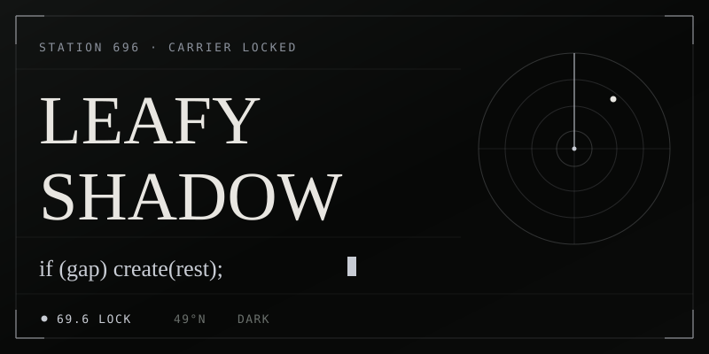

<p align="center">
  
</p>

<p align="center">
  <strong>František Kalášek</strong><br/>
  Czech Republic · 49°N · dark mode, always
</p>

<p align="center">
  <a href="https://fkv.me">website</a>
  &nbsp;&nbsp;·&nbsp;&nbsp;
  <a href="mailto:Lshadow696@fkv.me">transmit</a>
  &nbsp;&nbsp;·&nbsp;&nbsp;
  <a href="https://x.com/LeafyShadowQQ">x</a>
  &nbsp;&nbsp;·&nbsp;&nbsp;
  <a href="https://github.com/LShadow696">github</a>
</p>

I build practical, human-centered web apps. The case I care about is the gap: two phones, a dead zone, a message that still arrives.

<pre>if (gap) create(rest);</pre>


## Dossiers

> **01 · Pro Tebe** &nbsp;&nbsp;`LIVE`<br/>
> A shared room for two. Messages, photos, and memories — and an offline cache, so the note still lands when the tower doesn't.<br/>
> [Enter the room](https://toget-us.lovable.app) · private product<br/>
> TypeScript · React · TanStack · Supabase

> **02 · Společníci** &nbsp;&nbsp;`OPEN`<br/>
> A Czech pack of companions you talk to. Local voice, a mood, a bond that changes. A parťák, not a help desk.<br/>
> [Open the source](https://github.com/LShadow696/Companions) · public repository<br/>
> TypeScript · TanStack Start · Postgres

## Signal

**Now** — Pro Tebe is live. Společníci is public.

**Stack** — TypeScript, React, TanStack, Vite, Tailwind, Supabase, PostgreSQL, Node.js

**Rule** — Constraint first. If it only works on a perfect connection, it isn't finished.

**Ask** — Don't pitch a slide. Pitch a constraint.

## Handshake

[write](mailto:Lshadow696@fkv.me) · [fkv.me](https://fkv.me)

<details>
<summary>decrypt</summary>

```text
whoami      František Kalášek
callsign    Leafy Shadow
freq        69.6 locked
ping        the tower — it will fail
deadzone    drop the tower on purpose
archive     mailersend studio — public repo is down
decrypt     if (gap) create(rest);
```

Bridge the gap. Create the rest.

</details>
