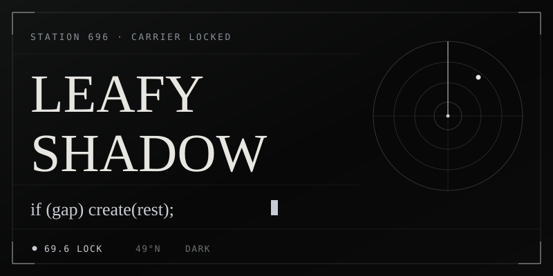
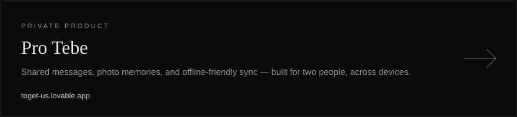
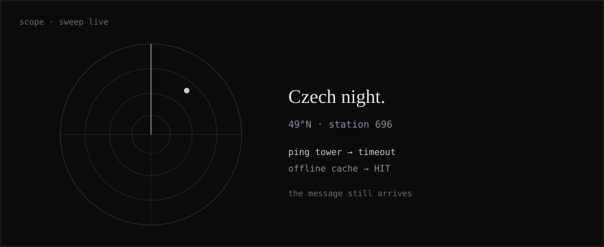
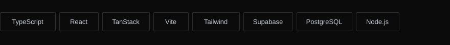

<p align="center">
  
</p>

<p align="center">
  <strong>František Kalášek · Leafy Shadow</strong><br/>
  Czech Republic · 49°N · building for the dead zone
</p>

<p align="center">
  <a href="#work">Work</a>
  &nbsp;·&nbsp;
  <a href="#principle">Principle</a>
  &nbsp;·&nbsp;
  <a href="#toolkit">Toolkit</a>
  &nbsp;·&nbsp;
  <a href="#contact">Contact</a>
</p>

I build practical, human-centered web apps. I care about the moments when a connection drops, a message matters, and the experience should keep going.

<p align="center"><code>if (gap) create(rest);</code></p>

## Work

<p align="center">
  <a href="https://toget-us.lovable.app">
    
  </a>
</p>

**Pro Tebe** is a private space for two to share messages, photos, and memories. It is live, with an offline cache so a note can still arrive when the tower doesn't.

[Open Pro Tebe](https://toget-us.lovable.app)

## Principle

<p align="center">
  
</p>

**Constraint first.** A useful app should account for unreliable connections, not just the perfect-network demo.

## Toolkit

<p align="center">
  
</p>

## Contact

[Email](mailto:Lshadow696@fkv.me) · [X](https://x.com/LeafyShadowQQ) · [GitHub](https://github.com/LShadow696)

<details>
<summary>Decrypt</summary>

```text
whoami      František Kalášek
callsign    Leafy Shadow
freq        69.6 locked
ping        the tower — it will fail
deadzone    drop the tower on purpose
decrypt     if (gap) create(rest);
```

Bridge the gap. Create the rest.

</details>
